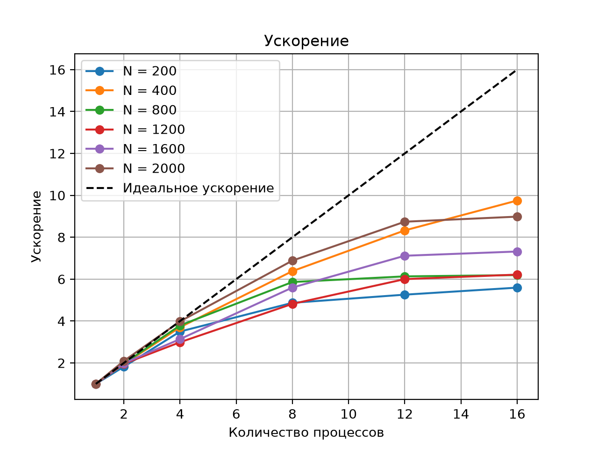
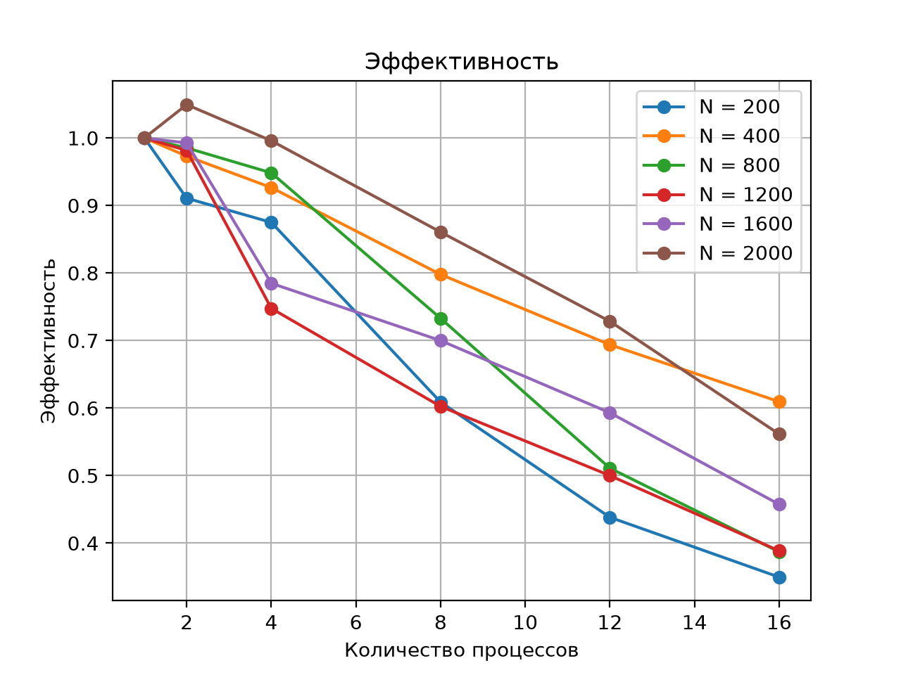
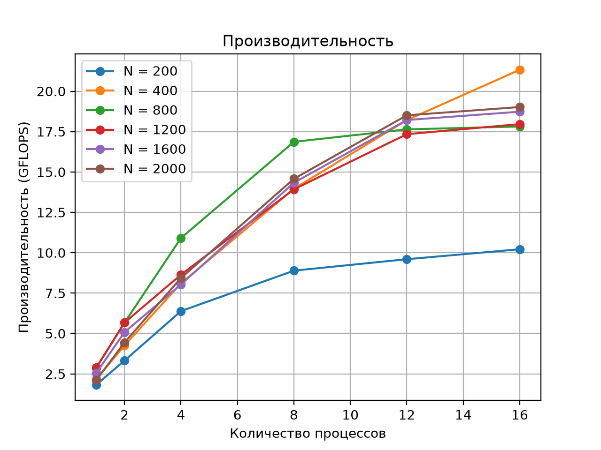

# Лабораторная работа №3

**Автор:** Мошков Кирилл

---

## Структура проекта
- [src/main.cpp](src/main.cpp) - основной код.
- [src/job.sh](src/job.sh) - скрипт, который проводит все эксперименты и собирает результаты в таблицу.
- [src/create_graph.py](src/create_graph.py) - скрипт для усреднения результатов и построения графиков.
- [results/results.csv](results/results.csv) - исходные данные всех запусков.
- [results/results_avg.csv](results/results_avg.csv) - средние значения.
- [graphs](graphs) - графики.

---

## Сбор статистики

Размеры матриц: 200, 400, 800, 1200, 1600, 2000.

Количество процессов: 1, 2, 4, 8, 12, 16.

На каждую комбинацию размера и числа процессов выполнено по 3 запуска. В [results/results_avg.csv](results/results_avg.csv) приведены средние значения, исходные данные находятся в [results/results.csv](results/results.csv).

Ускорение и эффективность считаются по формулам:

```math
S(p) = \frac{T_1}{T_p}, \qquad E(p) = \frac{S(p)}{p}
```

Производительность считается как $`\dfrac{2N^3}{T \cdot 10^9}`$ GFLOPS.

---

## Конфигурация стенда

Расчёты проводились на одном узле кластера «Сергей Королёв».

---

## Результаты

Средние значения по всем запускам: [results/results_avg.csv](results/results_avg.csv)

Исходные данные всех запусков: [results/results.csv](results/results.csv)

| Размер матрицы (N×N) | Количество процессов | Время умножения (с) | Количество операций (FLOP) | Производительность (GFLOPS) | Ускорение | Эффективность |
| :---: | :---: | :---: | :---: | :---: | :---: | :---: |
| **200** | 1 | 0,008770 | 16000000 | 1,8257 | 1,000 | 1,000 |
|  | 2 | 0,004815 | 16000000 | 3,3232 | 1,821 | 0,911 |
|  | 4 | 0,002506 | 16000000 | 6,3845 | 3,499 | 0,875 |
|  | 8 | 0,001801 | 16000000 | 8,8898 | 4,870 | 0,609 |
|  | 12 | 0,001668 | 16000000 | 9,5985 | 5,259 | 0,438 |
|  | 16 | 0,001568 | 16000000 | 10,2145 | 5,594 | 0,350 |
| **400** | 1 | 0,058522 | 128000000 | 2,1872 | 1,000 | 1,000 |
|  | 2 | 0,030072 | 128000000 | 4,2564 | 1,946 | 0,973 |
|  | 4 | 0,015792 | 128000000 | 8,1055 | 3,706 | 0,926 |
|  | 8 | 0,009169 | 128000000 | 13,9601 | 6,383 | 0,798 |
|  | 12 | 0,007029 | 128000000 | 18,2089 | 8,325 | 0,694 |
|  | 16 | 0,006002 | 128000000 | 21,3276 | 9,751 | 0,609 |
| **800** | 1 | 0,355977 | 1024000000 | 2,8767 | 1,000 | 1,000 |
|  | 2 | 0,180658 | 1024000000 | 5,6683 | 1,970 | 0,985 |
|  | 4 | 0,093854 | 1024000000 | 10,9106 | 3,793 | 0,948 |
|  | 8 | 0,060719 | 1024000000 | 16,8650 | 5,863 | 0,733 |
|  | 12 | 0,058058 | 1024000000 | 17,6377 | 6,131 | 0,511 |
|  | 16 | 0,057485 | 1024000000 | 17,8136 | 6,193 | 0,387 |
| **1200** | 1 | 1,196013 | 3456000000 | 2,8896 | 1,000 | 1,000 |
|  | 2 | 0,609343 | 3456000000 | 5,6717 | 1,963 | 0,981 |
|  | 4 | 0,399980 | 3456000000 | 8,6405 | 2,990 | 0,748 |
|  | 8 | 0,248180 | 3456000000 | 13,9254 | 4,819 | 0,602 |
|  | 12 | 0,199328 | 3456000000 | 17,3387 | 6,000 | 0,500 |
|  | 16 | 0,192404 | 3456000000 | 17,9623 | 6,216 | 0,389 |
| **1600** | 1 | 3,200299 | 8192000000 | 2,5599 | 1,000 | 1,000 |
|  | 2 | 1,612301 | 8192000000 | 5,0810 | 1,985 | 0,992 |
|  | 4 | 1,019531 | 8192000000 | 8,0384 | 3,139 | 0,785 |
|  | 8 | 0,571600 | 8192000000 | 14,3321 | 5,599 | 0,700 |
|  | 12 | 0,449731 | 8192000000 | 18,2158 | 7,116 | 0,593 |
|  | 16 | 0,437336 | 8192000000 | 18,7316 | 7,318 | 0,457 |
| **2000** | 1 | 7,556552 | 16000000000 | 2,1174 | 1,000 | 1,000 |
|  | 2 | 3,600811 | 16000000000 | 4,4434 | 2,099 | 1,049 |
|  | 4 | 1,897093 | 16000000000 | 8,4340 | 3,983 | 0,996 |
|  | 8 | 1,097591 | 16000000000 | 14,5777 | 6,885 | 0,861 |
|  | 12 | 0,864550 | 16000000000 | 18,5070 | 8,740 | 0,728 |
|  | 16 | 0,841276 | 16000000000 | 19,0188 | 8,982 | 0,561 |

---

## Графики

<p align="center">
  
  
  
</p>

---

## Вывод

1. **Ускорение.** С ростом числа процессов время умножения уменьшается. Для $`N = 2000`$ время на одном процессе составило **7,556552 с**, а на 16 процессах **0,841276 с**, то есть ускорение $`S(16) \approx 8{,}98`$. Для $`N = 400`$ время упало с **0,058522 с** до **0,006002 с** ($`S(16) \approx 9{,}75`$).
2. **Влияние размера матрицы.** Эффективность $`E(p)`$ падает с ростом $`p`$ для всех размеров, но на больших матрицах она выше. На 16 процессах для $`N = 200`$ она равна **0,350**, а для $`N = 2000`$ равна **0,561**. На маленьких матрицах доля пересылки данных в общем времени больше.
3. **Производительность.** Максимум зафиксирован при $`N = 400`$ на 16 процессах и составил **21,3276 GFLOPS**. На одном процессе производительность около 2-3 GFLOPS, на 16 процессах около 18-21 GFLOPS (для $`N = 200`$ только 10,2 GFLOPS).
4. **Насыщение.** При переходе с 12 на 16 процессов выигрыш мал. Для $`N = 800`$ время изменилось с **0,058058 с** до **0,057485 с**, для $`N = 1600`$ с **0,449731 с** до **0,437336 с**. Пересылка матрицы $`B`$ и лент $`A`$ и $`C`$ занимает всё большую долю времени, а сама работа каждого процесса уменьшается.
5. **Эффективность больше 1.** Для $`N = 2000`$ на 2 процессах эффективность получилась **1,049**. Скорее всего, на одном процессе матрицы не помещаются в кэш и вычисления идут медленнее, а при делении на ленты данные на процесс уменьшаются и кэш используется лучше.
