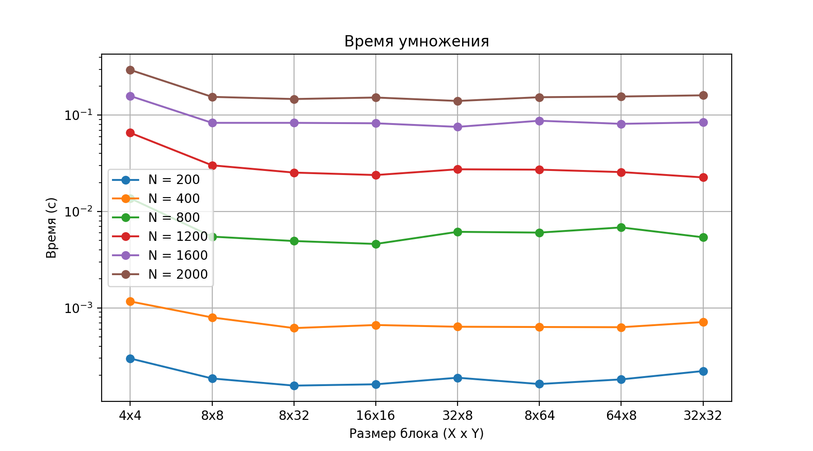
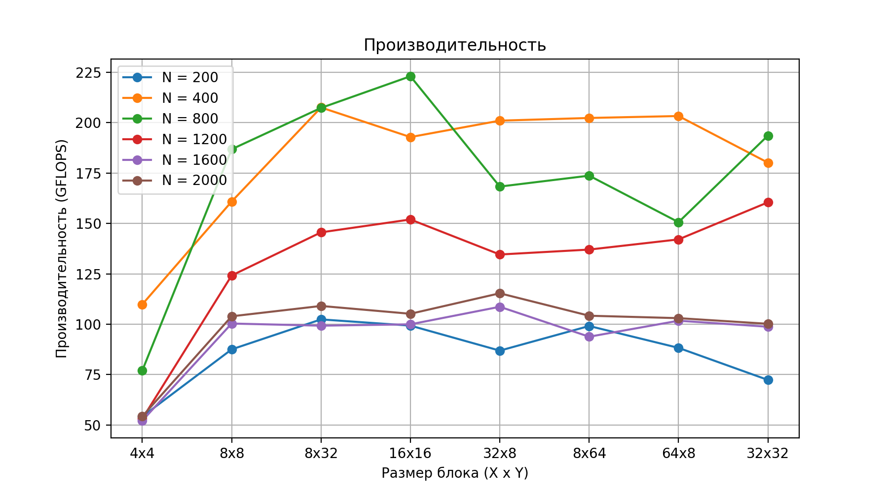
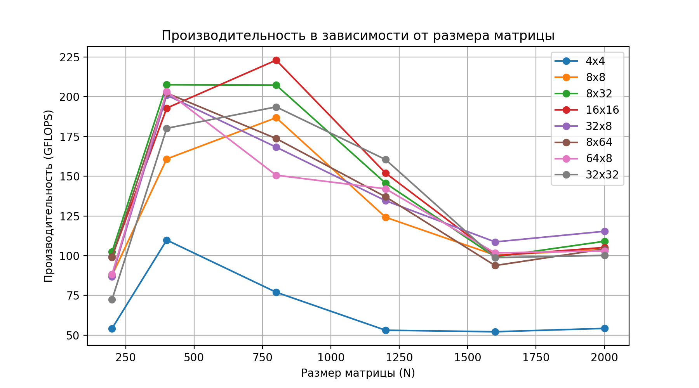

# Лабораторная работа №4

**Автор:** Мошков Кирилл

---

## Структура проекта
- [src/main.cu](src/main.cu) - основной код программы.
- [src/run.sh](src/run.sh) - скрипт, который собирает программу, проводит все эксперименты и собирает результаты в таблицу.
- [src/create_graph.py](src/create_graph.py) - скрипт для усреднения результатов и построения графиков.
- [results/results.csv](results/results.csv) - исходные данные всех запусков.
- [results/results_avg.csv](results/results_avg.csv) - средние значения.
- [graphs](graphs) - графики.

---

## Алгоритм

Один поток считает один элемент $`C_{ij}`$. Потоки объединяются в блоки размера $`b_x \times b_y`$, а блоки образуют сетку, которая покрывает всю матрицу:

```math
G_x = \left\lceil \frac{N}{b_x} \right\rceil, \qquad G_y = \left\lceil \frac{N}{b_y} \right\rceil
```

```cpp
__global__ void Multiply(
    const double* first,
    const double* second,
    double* result,
    int size
) {
    int col = blockIdx.x * blockDim.x + threadIdx.x;
    int row = blockIdx.y * blockDim.y + threadIdx.y;

    if (row < size && col < size) {
        double sum = 0.0;

        for (int k = 0; k < size; ++k) {
            sum += first[row * size + k] * second[k * size + col];
        }

        result[row * size + col] = sum;
    }
}
```

Время замеряется через `cudaEvent` только для работы ядра, копирование данных между памятью компьютера и видеокартой в замер не входит.

---

## Сбор статистики

Размеры матриц: 200, 400, 800, 1200, 1600, 2000.

Конфигурации блока (X×Y): 4×4, 8×8, 8×32, 16×16, 32×8, 8×64, 64×8, 32×32. В блоке не может быть больше 1024 потоков.

На каждую комбинацию размера матрицы и конфигурации блока выполнено по 3 запуска. В [results/results_avg.csv](results/results_avg.csv) приведены средние значения, исходные данные находятся в [results/results.csv](results/results.csv).

Производительность считается как $`\dfrac{2N^3}{T \cdot 10^9}`$ GFLOPS.

---

## Конфигурация стенда

Расчёты проводились в Google Colab.

- Видеокарта: NVIDIA Tesla T4, 15360 МиБ, драйвер 580.82.07
- Компилятор: nvcc, CUDA 13.0 (`nvcc -O3`)
- Процессор: Intel Xeon 2,00 ГГц
- Оперативная память: 12 ГиБ

---

## Результаты

Средние значения по всем запускам: [results/results_avg.csv](results/results_avg.csv)

Исходные данные всех запусков: [results/results.csv](results/results.csv)

| Размер матрицы (N×N) | Блок (X×Y) | Размер сетки | Время умножения (с) | Производительность (GFLOPS) |
| :---: | :---: | :---: | :---: | :---: |
| **200** | 4×4 | 50×50 | 0,000298 | 54,1799 |
|  | 8×8 | 25×25 | 0,000185 | 87,5231 |
|  | 8×32 | 25×7 | 0,000156 | 102,3897 |
|  | 16×16 | 13×13 | 0,000161 | 99,3085 |
|  | 32×8 | 7×25 | 0,000188 | 86,8909 |
|  | 8×64 | 25×4 | 0,000162 | 99,1148 |
|  | 64×8 | 4×25 | 0,000181 | 88,2659 |
|  | 32×32 | 7×7 | 0,000221 | 72,3608 |
| **400** | 4×4 | 100×100 | 0,001166 | 109,8355 |
|  | 8×8 | 50×50 | 0,000796 | 160,8707 |
|  | 8×32 | 50×13 | 0,000617 | 207,5263 |
|  | 16×16 | 25×25 | 0,000664 | 192,8422 |
|  | 32×8 | 13×50 | 0,000637 | 200,9918 |
|  | 8×64 | 50×7 | 0,000633 | 202,3220 |
|  | 64×8 | 7×50 | 0,000630 | 203,2852 |
|  | 32×32 | 13×13 | 0,000712 | 180,1570 |
| **800** | 4×4 | 200×200 | 0,013715 | 77,0117 |
|  | 8×8 | 100×100 | 0,005489 | 186,8089 |
|  | 8×32 | 100×25 | 0,004943 | 207,3135 |
|  | 16×16 | 50×50 | 0,004608 | 223,0138 |
|  | 32×8 | 25×100 | 0,006158 | 168,2859 |
|  | 8×64 | 100×13 | 0,006046 | 173,7042 |
|  | 64×8 | 13×100 | 0,006838 | 150,6199 |
|  | 32×32 | 25×25 | 0,005404 | 193,5986 |
| **1200** | 4×4 | 300×300 | 0,065625 | 53,0945 |
|  | 8×8 | 150×150 | 0,030187 | 124,1768 |
|  | 8×32 | 150×38 | 0,025378 | 145,5760 |
|  | 16×16 | 75×75 | 0,023926 | 151,9666 |
|  | 32×8 | 38×150 | 0,027448 | 134,5900 |
|  | 8×64 | 150×19 | 0,027209 | 137,0314 |
|  | 64×8 | 19×150 | 0,025680 | 142,0788 |
|  | 32×32 | 38×38 | 0,022612 | 160,4655 |
| **1600** | 4×4 | 400×400 | 0,158330 | 52,1542 |
|  | 8×8 | 200×200 | 0,083299 | 100,3444 |
|  | 8×32 | 200×50 | 0,083282 | 99,2741 |
|  | 16×16 | 100×100 | 0,082441 | 99,9491 |
|  | 32×8 | 50×200 | 0,075665 | 108,6541 |
|  | 8×64 | 200×25 | 0,087610 | 93,7964 |
|  | 64×8 | 25×200 | 0,081351 | 101,7397 |
|  | 32×32 | 50×50 | 0,084260 | 98,7616 |
| **2000** | 4×4 | 500×500 | 0,295206 | 54,2643 |
|  | 8×8 | 250×250 | 0,154996 | 103,9287 |
|  | 8×32 | 250×63 | 0,147155 | 109,0635 |
|  | 16×16 | 125×125 | 0,152588 | 105,1818 |
|  | 32×8 | 63×250 | 0,140524 | 115,3478 |
|  | 8×64 | 250×32 | 0,153692 | 104,2145 |
|  | 64×8 | 32×250 | 0,156283 | 103,0110 |
|  | 32×32 | 63×63 | 0,160844 | 100,2084 |

---

## Графики

<p align="center">
  
  
  
</p>

---

## Вывод

1. **Блок 4×4 самый медленный при всех размерах матриц.** Его производительность 52-110 GFLOPS, это в 1,9-3,0 раза хуже лучшей конфигурации при том же $`N`$. В блоке 4×4 всего 16 потоков, а видеокарта выполняет потоки группами по 32, поэтому половина группы простаивает.
2. **Остальные конфигурации близки.** Например, при $`N = 2000`$ они дают 100-115 GFLOPS. Лучшая конфигурация зависит от размера: 8×32 при $`N = 200`$ и $`N = 400`$, 16×16 при $`N = 800`$, 32×32 при $`N = 1200`$, 32×8 при $`N = 1600`$ и $`N = 2000`$. Единственной лучшей конфигурации нет, а разница между ними на малых матрицах сравнима с погрешностью замера, так как время расчёта измеряется долями миллисекунды.
3. **Форма блока.** Конфигурации 16×16, 32×8 и 8×32 содержат одинаковое число потоков (256), но дают разный результат. При $`N = 800`$ это 223,01, 168,29 и 207,31 GFLOPS, при $`N = 2000`$ это 105,18, 115,35 и 109,06 GFLOPS. Одна и та же форма не оказывается лучшей при всех размерах.
4. **Максимум производительности** 223,01 GFLOPS получен при $`N = 800`$ на блоке 16×16 (время 0,004608 с).
